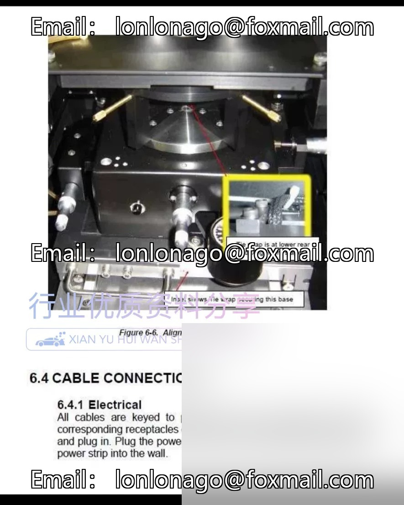
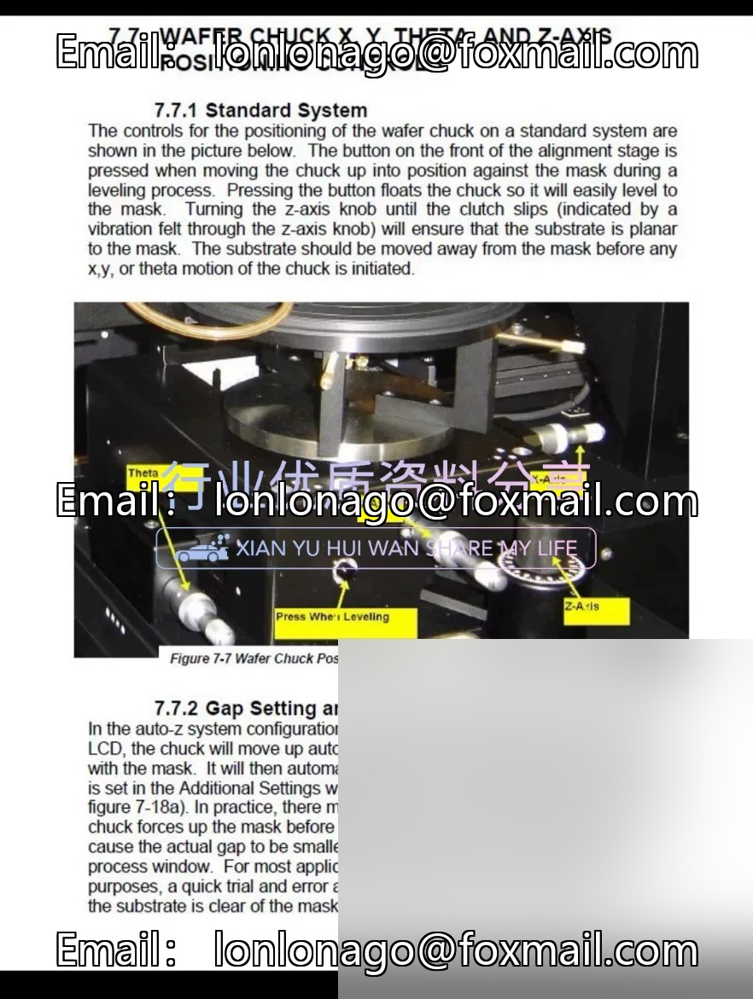
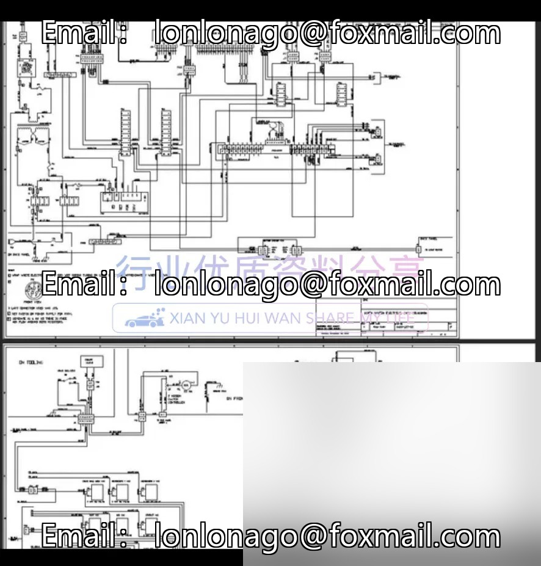
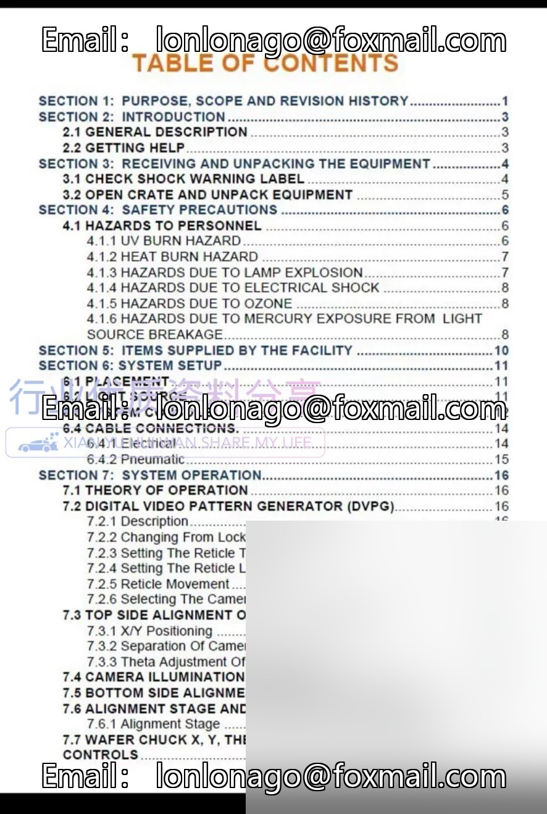
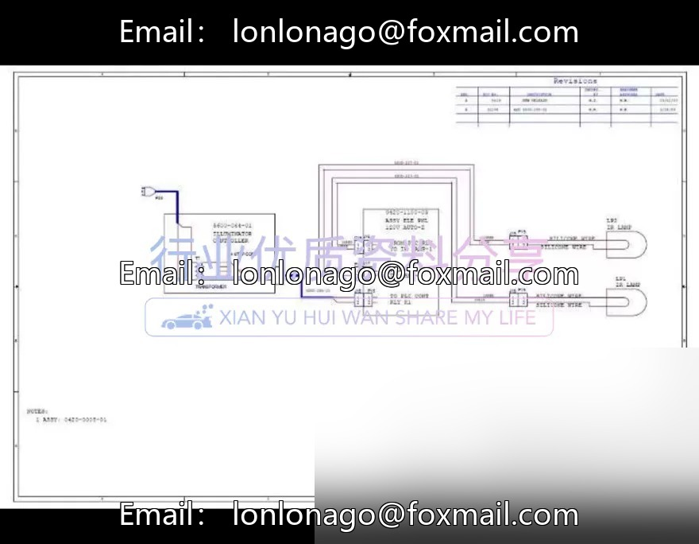
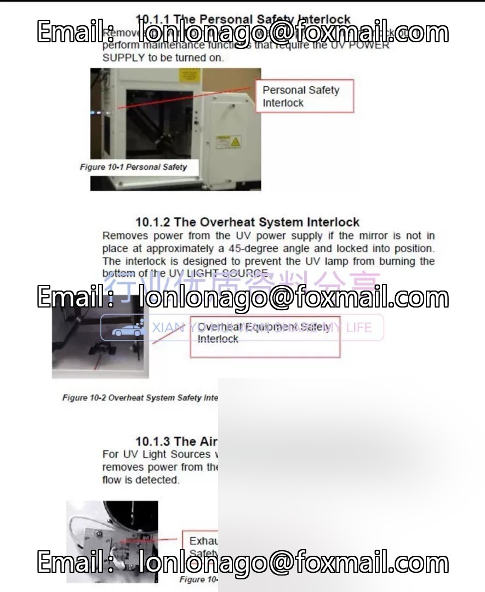

# American OAI Model 800MBA dual-side exposure machine / semi-automated photolithography

## Body

American OAI Model 800MBA double-sided exposure machine / semi-automated photolithography machine electronic technical data, with comprehensive content including equipment structure descriptions, operation methods and circuit diagrams, large reference value.

Capture and send the electronic original directly! The following images include screenshots of the file portion. Please confirm before placing the order! Due to the replicable nature of electronic documentation Therefore, are allowed after purchase! Thanks for understanding!

For personal learning and reference use only.

The electronic technical materials cover the US OAI Model 800MBA double-sided exposure machine and semi-auto lithography; they also include device structure descriptions, operation methods, circuit diagrams and related screenshots.

<!-- AI_ENRICHED -->

## Images

## Payment

Here is a pay link on Stripe ( https://buy.stripe.com/3cs8yP7sY87d0vu9AB ). Please contact me lonlonago@foxmail.com after funding $89, and I will send you a complete data files , thank you!

